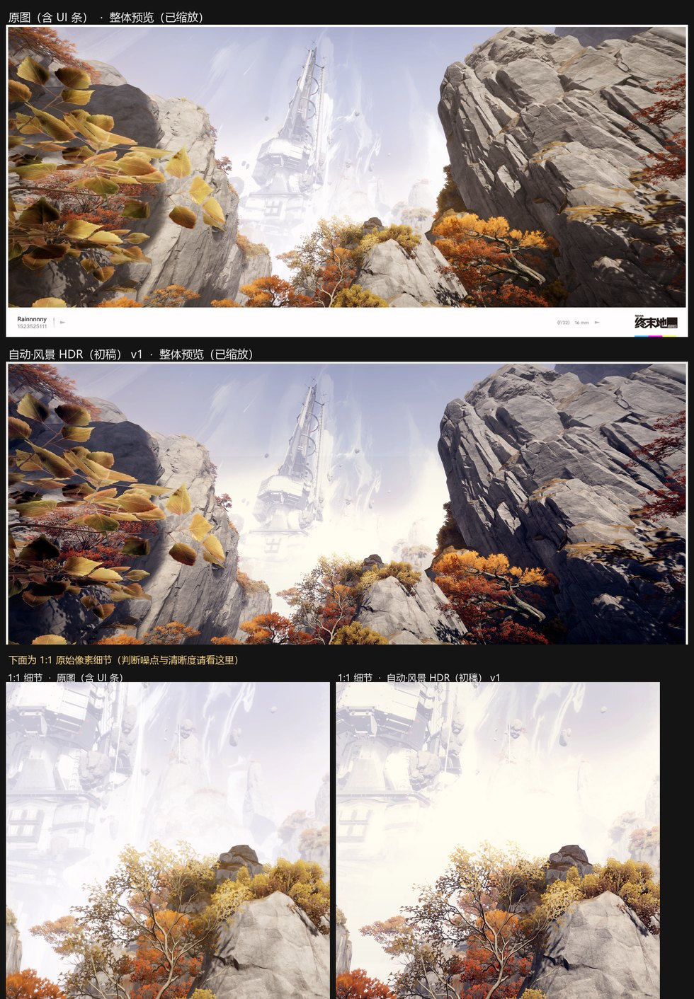
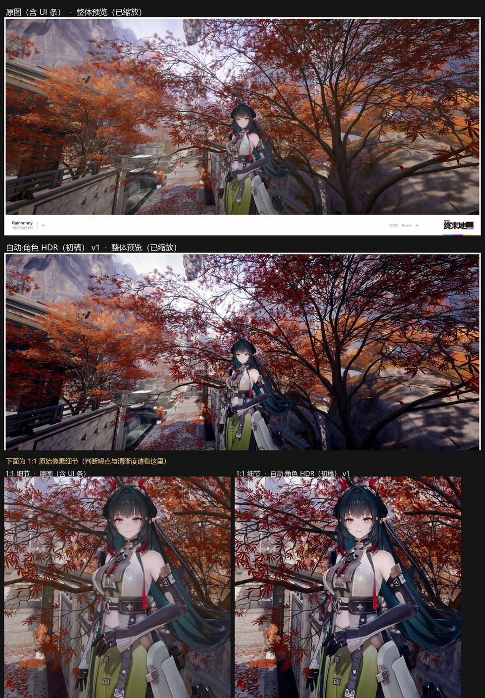
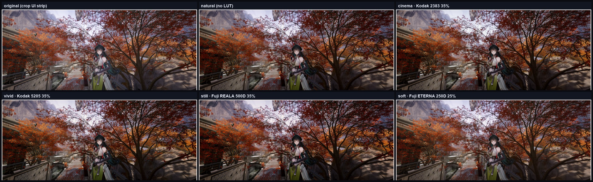
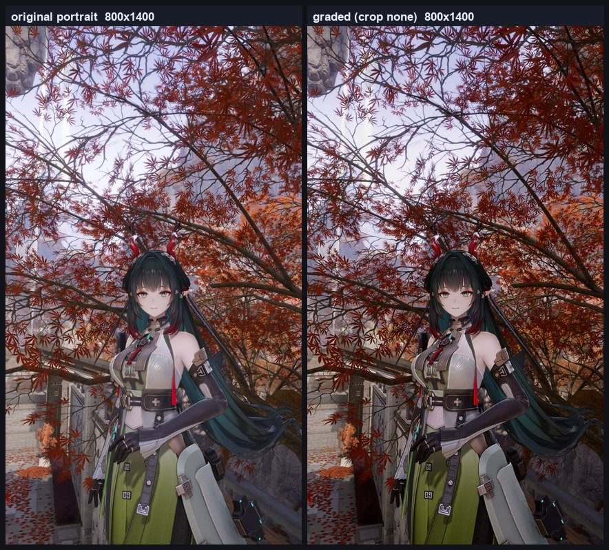
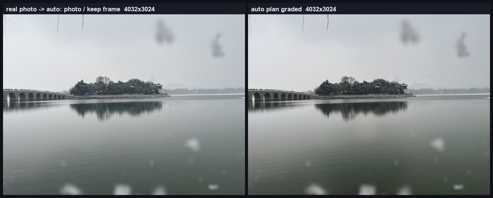

# Lumina · 光

> DSH 的 Photoshop 后期套件：用脚本驱动**本机 Adobe Photoshop** 做游戏截图 / 照片后期 —— 常驻会话、参数化 recipe、自动出片、客观质检、风格 LUT、HDR 高光重建、可选超分与像素级视觉检视。

Lumina 是一个 [DSH](https://github.com/deepseek-ai) 宿主插件（bundle）。它把「命令行调 PS」这种每轮要权限审批、6 秒冷启动、手写 JSX、静默失效试错的流程，变成 **≈5 秒一轮 + 自动指标 + 可复现参数** 的日常出片工具：

- **常驻 Photoshop 会话**：一次冷启动，之后每张图 ~5 秒；崩溃/被杀后自动重启重试。
- **参数化 recipe**：19 个调色配方 + 5 档内置风格 LUT；参数全部可深合并覆盖、可追加版本迭代，**风格本身是热加载的数据包**（新增/替换不用重启，也能做成纯参数预设）。
- **通用画幅**：游戏截图、真实照片、竖拍/方图/超宽图都能跑；只有检测置信度高的截图 UI 条才会被裁掉。
- **自动模式**：丢一张图即可——自动裁 UI 条、判定角色/风景、按需 HDR 高光重建、套用验收过的初稿参数。
- **可选超分预处理**：低清/小图可先接外部 AI 超分（Real-ESRGAN / waifu2x 等），没有外部工具时用内置 Lanczos 兜底，再走 HDR 重建与调色。
- **客观质检**：高光溢出、锐度、中间调、饱和度、输出尺寸，达不达标直接列出来；auto 模式还能自愈重跑。
- **每任务工程目录**：原图、实际执行的 JSX、PSD、成品、前后指标、1:1 对比图、版本历史全部落盘可复现。
- **视觉工具**：高倍坐标网格看图、像素探针、原生分辨率文本像素图——不受图像 token 上限限制。

## 截图

| 自动 · 风景（HDR 重建 + 前后对比） | 自动 · 角色（cinema 风格 LUT） |
|---|---|
|  |  |

风格库 5 档对比（原图 → natural → cinema → vivid → still → soft）：



## 工具

| 工具 | 作用 |
|---|---|
| `ps_grade` | 对图片执行 recipe：自动建工程目录、**通用自动判断（截图/照片、清晰度、UI 条、EXIF 方向，低清模糊自动超分，坏引擎自动回落）**、调色/分层、出 PNG/PSD、生成含 1:1 细节的前后对比图、算指标、跑质量校验。可带 `project` 追加新版本调参；`crop:{"mode":"none"}` 保留完整分辨率。 |
| `ps_measure` | 任意图片的质量指标（亮度分布、高光/暗部溢出、饱和度、锐度、尺寸、UI 条）+ **自动评估：模糊度、噪声、EXIF 方向、照片/截图判断**。不修改文件。 |
| `ps_state` | Photoshop 会话状态、LUT 目录、案例库、热加载风格包、超分设置、可用 recipe / 风格、最近工程列表。`start=true` 预热，`quit=true` 释放内存。 |
| `vision_zoom` | 高分辨率看图：区域放大 + 原图坐标网格 + 边缘叠加 + 标记点，直接把图返回给模型看。 |
| `vision_probe` | 像素探针：读取指定坐标/线段上采样点的精确 RGB、亮度、边缘强度。 |
| `vision_textmap` | 把图片区域渲染成原生分辨率「文本像素图」，不受图像 token/尺寸上限限制。 |

## 安装

### 环境要求

**Photoshop 兼容矩阵**：2025（26.x）✅ 已实测；2020–2024 预期支持（旧版 `Select Subject` 失败会自动回退出图）；2019 及更早不保证；PS Elements / macOS 不支持（插件依赖 Windows COM）。

- Windows 10/11 + **Adobe Photoshop**（开发与验收于 Photoshop 2025；`ps_grade` 依赖 Windows COM，更早版本未验证）。
- [DSH](https://github.com/deepseek-ai) 桌面端（宿主插件运行在 DSH 宿主进程，才能启动 Photoshop COM）。
- Node.js ≥ 20（DSH 自带运行时即可）。
- Python 3.10+，带 `numpy`、`Pillow`（DSH 自带运行时已包含；独立使用时装一下即可）。

> Photoshop 的**安装路径不需要配置**：自动化通过系统里 Photoshop 的 COM 注册启动；
> 只有风格 LUT 需要找到 `Presets/3DLUTs`，会自动探测（见下文），特殊安装可配 `lutDir`。

### 通过 DSH 插件安装

把本仓库放到任意目录，在 DSH profile 里以 `link:` / `file:` 依赖安装并加入 bundle 列表，例如
`C:\Users\<you>\.dsh\profiles\<profile>\package.json`：

```json
{
  "dependencies": {
    "lumina-dsh": "link:C:/path/to/lumina-oss"
  },
  "dsh": {
    "profile": {
      "bundles": ["@deepseek-ai/dsh-base", "@deepseek-ai/dsh-web-app", "lumina-dsh"]
    }
  }
}
```

安装依赖（或直接把仓库目录软链到 `<profile>/node_modules/lumina-dsh`）后重启 DSH。
插件里的 `cordis.patch.yml` 会自动注册 `ps_grade` / `ps_measure` / `ps_state` /
`vision_zoom` / `vision_probe` / `vision_textmap` 六个工具。

### 配置（可选）

所有配置项都可省略；未写的项使用下表的默认值。`cordis.patch.yml` 配置示例：

```yaml
- insert:
    - id: photoshop
      name: 'lumina-dsh'
      config:
        projectRoot: 'D:/Photos/Lumina'   # 默认 <home>/Lumina
        # pythonPath: 'C:/Python312/python.exe'   # 默认用 DSH 自带 Python
        # lutDir: 'C:/Program Files/Adobe/Adobe Photoshop 2025/Presets/3DLUTs'
        # casesFile: 'D:/Photos/Lumina/.lumina-cases.json'
        psWaitMs: 90000        # 冷启动 Photoshop 最长等待
        opTimeoutMs: 240000    # 单张图处理超时
        maxViewDimension: 4096 # vision_zoom 最大视图尺寸
```

| 配置项 | 默认值 | 说明 |
|---|---|---|
| `projectRoot` | `<home>/Lumina` | 每个任务的工程目录建在这里；也支持 `LUMINA_PROJECT_ROOT` 环境变量 |
| `pythonPath` | 自动 | Python 解释器；也支持 `LUMINA_PYTHON` / `DSH_PYTHON` |
| `lutDir` | 自动探测 | Photoshop `Presets/3DLUTs` 目录；也支持 `LUMINA_LUT_DIR` |
| `casesFile` | `<home>/.lumina/auto-cases.json` | 可写的风格案例库；也支持 `LUMINA_CASES_FILE` |
| `casesSeedFile` | `<package>/assets/auto-cases.json` | 只读种子案例库（发布包为空/不存在） |
| `stylesFile` | `<home>/.lumina/styles.json` | 热加载用户风格包（同名覆盖内置风格）；也支持 `LUMINA_STYLES_FILE` |
| `superResolution` | 关闭 | 超分预处理默认参数（见「超分预处理」）；`fallback` 控制坏引擎回落 |
| `assess` | 内置阈值 | 可覆盖通用自动判断阈值：`{minLongEdge, blurThreshold, maxBlurUpscaleEdge, maxLongEdge, photoRecipe}` |
| `psWaitMs` / `opTimeoutMs` | `90000` / `240000` | 启动等待 / 单步超时（毫秒） |
| `maxViewDimension` | `4096` | vision_zoom 输出图像上限（模型侧图像尺寸上限） |

更多环境变量别名：`LUMINA_CASES_SEED`、`LUMINA_STYLES_FILE`、`DSH_LUMINA_LUT_DIR`、`DSH_LUMINA_CASES_FILE`、`DSH_PHOTOSHOP_PROJECT_ROOT`、`DSH_PHOTOSHOP_PYTHON`、`DSH_VISION_PYTHON`；排障时设 `LUMINA_DEBUG=1`（或 `DSH_PHOTOSHOP_DEBUG=1`）输出宿主侧调试日志。

### 用户配置文件（本机设置，不进仓库/发布包）

不想改插件配置、又要把工程和运行数据放到别的盘时，用**用户配置文件**：

`<home>/.lumina/config.json`（或环境变量 `LUMINA_CONFIG` 指向任意路径）

```jsonc
// C:/Users/<you>/.lumina/config.json —— 例如全部放 D 盘
{
  "projectRoot": "D:/Photos/LuminaProjects",  // 工程目录（成品/PSD/对比图都在里面）
  "dataDir": "D:/Photos/LuminaData",          // 案例库/风格包/缓存等运行数据的默认目录
  "lutDir": "D:/PS/Presets/3DLUTs",           // 可选：非标准 Photoshop 安装位置
  "stylesFile": "D:/Photos/LuminaData/styles.json",  // 可选：显式指定（否则 <dataDir>/styles.json）
  "casesFile": "D:/Photos/LuminaData/auto-cases.json",
  "superResolution": { "enabled": true, "mode": "auto", "minLongEdge": 1600, "scale": 2 }
}
```

完整优先级：**插件配置（cordis.patch.yml） > 环境变量 > 用户配置文件 > 内置默认**。
用户文件在插件加载时读取（改完重启/重载 DSH 生效）；案例库与风格包本身仍是每次调用热加载。

可以直接复制仓库里的示例：`assets/config.example.json` → `<home>/.lumina/config.json`，再按自己的盘符改路径（示例把工程与运行数据都放在 `D:/Lumina`）。

## 快速开始

> 首次安装：在对话里说 **hilumina**（或「初始化」）。插件会自检依赖/配置、探测 GPU 显存/磁盘/运行时，展示**完整档位表**（SUPIR(扩散) → HAT/DAT → UltraSharp/Remacri → Real-ESRGAN → waifu2x → Lanczos，含状态/体积/适配器/许可）与当前引擎链，然后**每次都会明确询问两项**：输出文件夹（当前值，可改）和 CUDA 兜底模型（SUPIR 仍是链上最高优先）。缺的档位可一键后台下载；`ps_state` 传 `onboard:true, forceAsk:true` 会额外加一条写入确认（首次装机/测试用）。

```jsonc
// 零提示词：丢一张截图，自动出片
{ "source": "C:/Photos/MyScreenshot.png", "auto": true }

// 指定 recipe + 标题
{ "source": "C:/Photos/MyScreenshot.png", "recipe": "clean-premium", "title": "夜景初稿" }

// 增加电影感风格 LUT
{ "source": "C:/Photos/MyScreenshot.png", "auto": true, "style": "cinema" }

// 对已有工程追加参数版本（不重新建目录）
{ "project": "20261024-214504-自动-峡谷", "recipe": "atmospheric-depth",
  "params": { "vignette": 30, "tone": { "gamma": 0.88 } } }
```

任务结果会返回：工程目录、成品 PNG、PSD、对比图、前后指标、质量校验、warnings。
不达标时带 `project` 加参数再跑一版即可，历史版本都会记录。

## 任意图片自动处理（游戏截图 / 真实照片 / 模糊图）

`auto:true` 是**通用自动路径**：不需要告诉插件这是游戏截图还是照片、清不清晰——丢一张图进去，插件自己评估并决定每一步，`plan` 会写进结果和 `project.json`。

自动判断链路：**评估 → 决策 → 执行 → 兜底**

1. **评估**（每次 auto 自动跑，无额外依赖）：分辨率/像素数、**尺度归一化模糊度**（固定 1024px 长边测量，跨分辨率可比）、噪声、EXIF（相机信息/方向）、UI 条检测、过曝率、AI 主体占比。
2. **决策**（默认阈值，可配置）：

| 条件 | 自动决策 |
|---|---|
| 长边 < `minLongEdge`（默认 1600）**或** 模糊度 < `blurThreshold`（默认 0.010，且长边 ≤ `maxBlurUpscaleEdge`） | **先超分**（AI 引擎可用用 AI；不可用自动回落内置 Lanczos），再调色 |
| 图像很大但偏模糊 | 不硬放大；给出「建议 AI 恢复」提示（可手动 `mode:"always", scale:1`） |
| UI 条检测置信度 high | 判为**截图**，裁掉底部 UI 条 |
| 无 UI 条 / 4:3、3:4 等照片画幅 / 相机 EXIF | 判为**照片**，保留完整画幅，用温和的 `clean-premium` 出片（不套游戏向 auto-* 配方、不走案例库） |
| 高光溢出 ≥ 阈值（仅截图/渲染图） | 先做 HDR 高光重建 |
| EXIF orientation ≠ 1（手机竖拍） | 自动转正后再处理，原图仍留在 `input/` |

3. **执行**：`超分（按需）→ HDR（按需）→ 裁剪/调色 → 风格`，工程/对比图/质检体系不变。
4. **兜底（质量优先链）**：按 **CUDA 双模型 → waifu2x Vulkan → ONNX/DirectML → Lanczos** 顺序自动降级；任一引擎不存在、启动失败、超时、显存不足，或**返回坏帧**（例如 50 系显卡上 2022 版 Real-ESRGAN：退出码 0 但输出近黑）→ 校验拦截并自动尝试下一级，最后回落 Lanczos（`fallback:"lanczos"`，可改 `"skip"`）；任何情况下主流程都能出片。

```jsonc
// 一个入口：自动识别截图/照片、自动判断是否超分
{ "source": "D:/Photos/whatever.jpg", "auto": true }

// 想固定走照片口味 / 保留完整画幅
{ "source": "D:/Photos/portrait.jpg", "auto": true, "crop": { "mode": "none" }, "style": "cinema" }

// 覆盖某个判断（例如强制按风景初稿）：
{ "source": "D:/Photos/street.jpg", "auto": { "scene": "landscape" } }
```

`ps_measure` 也会返回评估结果（模糊度、噪声、EXIF、照片/截图判断），方便先看清楚一张图再决定怎么处理。

**裁剪模式**（`crop` 参数，优先级高于自动判断）：

| `crop.mode` | 行为 | 适用 |
|---|---|---|
| `bottom-strip` | 检测并裁掉底部 UI 条；低置信度（<8px）自动忽略 | 游戏/App 截图 |
| `auto` | **只有检测置信度为 high 时才裁**，否则保留完整画面（照片自动走这个） | 真实照片（推荐） |
| `none` | 完全不裁，保留完整尺寸 | 照片 / 需要原尺寸时 |



**实测**（本机真实照片，12MP 手机实拍 3 张）：
- 2 张 4:3 风景 + 1 张 EXIF 旋转的竖图 → 全部自动判为 `photo`、保留完整画幅（4032×3024 / 3024×4032）、不误裁、不误触发超分；
- 同图缩小到 900px 并模糊后 → 自动判为低清+模糊，自动 ×2 出片（当前无 AI 引擎时用 Lanczos 兜底）；
- 伪造「坏帧 AI 引擎」（exit 0 输出近黑）→ 输出校验拦截并自动回落 Lanczos，出片正常。



- 分层蒙版的坐标（`person` 椭圆、`polygon`、`horizon`/`depth`）都是 0~1 相对值，换比例、换分辨率都可复用。
- 截图仍走原来的 `auto-character-*` / `auto-landscape-*` 配方与案例库，**行为与之前完全一致**（现有自动回归基线 Δ=0）。

## 自动模式（auto）

`auto: true` 时一次完成：

1. 裁掉截图底部 UI 条（自动检测，结果里给出置信度）；
2. **场景判定**：Photoshop「选择主体」AI 选区 + 颜色启发式 → 角色 / 风景；
3. **高光重建**：内容区高光溢出 ≥2.5% 时先跑 `assets/hdrsynth.py --sdr-mode neutral` 重建高光，再调色；
4. 套用验收过的初稿 recipe（`auto-character-hdr/natural`、`auto-landscape-hdr/natural`）；
5. 照常出对比图/PSD/metrics，并在 warnings 里写明判定依据。

```jsonc
{ "source": "C:/Photos/shot.png", "auto": { "style": "natural", "scene": "landscape", "hdrThreshold": 3.0 } }
{ "source": "C:/Photos/shot.png", "auto": { "recipe": "atmospheric-depth", "params": { "vignette": 24 } } }
```

自动模式是「初稿」：先省掉逐图选 recipe/调参，出片后一句话微调（带 `project` 追加版本）。

### 自动自愈

auto 模式下若质量校验未通过，会自动计算一个小参数补丁并**重跑一次**（只重试一次）：

| 未通过项 | 自动补丁 |
|---|---|
| `highlight_clip` | 全局输出白场 −4、bloom ×0.7；各分层白场 −3 |
| `midtones` / `mean` | 按目标中位值调整 tone gamma（clamp 0.62–1.35） |

重试结果作为新版本记录，warnings 写「首次未通过 xxx，已自动调参重跑为 vN」。可用 `selfHeal:false` 关闭。

### 风格案例库

- `learn:true` 把认可的版本入库：`{source, auto:true, learn:true}` 或 `{project, learn:{version:N, note:"定稿"}}`；
- 入库内容：图像特征（过曝率/洗白占比/均值/中位/主体占比/场景）、recipe、完整参数、风格；
- auto 出图前做**最近邻匹配**（距离 ≤0.85 命中），命中就复用那次的 recipe + 参数 + 风格，结果显示「案例库命中」；
- 案例分两层：只读**种子库** `assets/auto-cases.json`（可选，发布包不带私有案例） + 可写**用户库** `~/.lumina/auto-cases.json`；
- `ps_state` 会显示两个案例库路径与条数。

## 风格与 LUT

`style` 参数在调色完成后叠加一个 **3D LUT**（颜色查找表，纯颜色映射、不加颗粒、不改变分辨率）：

| style | 来源（Photoshop 自带 LUT） | 强度 | 效果 |
|---|---|---|---|
| `natural`（默认） | — | 0 | 不加 LUT |
| `cinema` | Kodak 5218 → Kodak 2383 印片模拟 | 35% | 高光偏暖、暗部偏青 |
| `vivid` | Kodak 5205 → Fuji 3510 | 35% | 更浓的暖色与对比 |
| `still` | Fuji REALA 500D → Kodak 2393 | 35% | 柔和的高光滚降 |
| `soft` | Fuji ETERNA 250D → Kodak 2395 | 25% | 最温和的一档 |

关键点：

- **LUT 文件不随插件分发**。用的是本机 Photoshop 自带的 `.cube`；按以下顺序自动定位：
  ① 配置项 `lutDir` → ② 环境变量 `LUMINA_LUT_DIR` → ③ Windows 注册表里 Photoshop 安装路径的 `Presets/3DLUTs` → ④ `%ProgramFiles%\Adobe\Adobe Photoshop*`。
  找不到时该风格自动跳过并给出 warning，其余流程不受影响。
- **清晰度守门**：叠加 LUT 后自动测锐度，若下降超过 2% 就自动把强度降到 60% 再试，仍不行则跳过该风格（清晰优先）。
- **PSD 是 LUT 前的版本**，成品 PNG 已包含 LUT（`work/style-vN.png` 保留 LUT 后中间图）。

### 自定义风格包（热加载、可替换）

内置 5 档风格只是起点；风格是**可替换的数据文件**，不是写死的代码：

1. 复制示例 `assets/styles.example.json` 到 `<home>/.lumina/styles.json`（或 `<dataDir>/styles.json`、或用插件配置 `stylesFile` 指定任意路径）；
2. 编辑后**下次 ps_grade 调用即刻生效**（按 mtime 热加载），不需要重启 DSH；同名风格会覆盖内置风格；
3. `ps_state` 里带 `*` 的风格就是用户包里的风格，并会显示 stylesFile 路径。

```jsonc
// ~/.lumina/styles.json
{
  "styles": {
    "teal-orange": {                    // 名字随意，ps_grade 的 style 直接传这个字符串
      "label": "青橙（自带调色）",
      "lut": "my-teal-orange.cube",     // 裸文件名：从 Photoshop Presets/3DLUTs 或 lutDir 找；
                                        // 也可写绝对路径 D:/MyLUTs/xxx.cube；null = 不加 LUT
      "strength": 40,
      "params": {                       // 可选：风格自带的参数预设，深合并到 recipe 之上
        "vignette": 18, "tone": { "gamma": 1.02 }, "desat": 4
      }
    },
    "warm-matte": {                     // 纯参数风格（不用 LUT 也能做成风格）
      "label": "暖调哑光",
      "lut": null,
      "params": { "tone": { "gamma": 0.9, "ob": 4 }, "vignette": 34, "desat": 4 }
    }
  }
}
```

- `lutDir` 也可写在单条风格里（只对这条风格生效），例如 `"lut": "x.cube", "lutDir": "D:/MyLUTs"`。
- `style` 参数是自由字符串：新增风格名**无需重启即可使用**；写错名字时报错会列出当前所有可用风格。
- 风格参数在 recipe/case 参数之后合并，适合「同一条 recipe 换不同味道」；出片记录（`project.json` 的 `params`/`style`）会完整保留，可复现。

## HDR 高光重建

8-bit 截图里超过/接近显示白的高光细节原始数据不可逆，但可以基于邻域**可信重建**：

```bash
python assets/hdrsynth.py --input original.png --out-dir out/hdr --crop-bottom 149
```

输出 `hdr-view.png`（SDR 观感）、RGB16 线性/PQ HDR、`gainmap.png`、`headroom.png`、`meta.json`。auto 模式在过曝率 ≥ 阈值时自动调用它；也可以手动预处理好再传给 `ps_grade`。

## 超分预处理（可选）

当原图分辨率/清晰度不够时，可以在调色前先跑一次**超分预处理**，再接 HDR 重建与调色（顺序：超分 → HDR → recipe）。

**质量优先（默认行为）**：配置多个引擎后按 `priority` 从高到低尝试——**CUDA 双模型（照片 x4plus / 游戏截图 anime_6B）→ waifu2x-ncnn-vulkan → ONNX/DirectML → 内置 Lanczos**；任一引擎失败、启动不了、超时或返回坏帧，自动尝试下一级，最后才回落 Lanczos，绝不阻断出片。

已在 RTX 5080 上实测 waifu2x-ncnn-vulkan 20250915（MIT，Vulkan 版）：3440×1578 → ×2 约 2.2 秒，900×675 照片 → ×2 约 1.1 秒；照片/游戏截图按 `{sourceKind}` 自动切换模型（照片 `models-upconv_7_photo`，截图/动漫 `models-cunet`）。

两个来源：

| 模式 | 说明 |
|---|---|
| **外部 AI 超分**（`command`） | 接任意命令行超分工具（Real-ESRGAN / waifu2x / Topaz 等）。插件只负责按模板调用、检查输出，**不打包任何模型**；模型和授权由你自备 |
| **内置 Lanczos**（默认兜底） | 无外部工具时用 Python Pillow 高质量缩放。确定性、零依赖，但**不会凭空增加细节**（不是 AI） |

触发方式（`mode`）：`auto` = 长边 < `minLongEdge` 或锐度 < `minSharpness` 时自动触发；`always` = 每次触发。
**auto 模式下由通用评估自动决定**：低清/模糊的图会在开启 `superResolution.enabled` 后自动超分，阈值见上文「任意图片自动处理」；未开启则只给提示、不静默放大。

```jsonc
// 单次调用：强制 2 倍超分
{ "source": "D:/Photos/lowres.jpg", "preprocess": {
    "superResolution": { "enabled": true, "mode": "always", "scale": 2 } } }

// 接本机 Real-ESRGAN（Windows ncnn 版示例）
{ "source": "D:/Photos/lowres.jpg", "preprocess": {
    "superResolution": {
      "enabled": true, "mode": "auto", "minLongEdge": 1600, "scale": 2,
      "command": "C:/Tools/realesrgan-ncnn-vulkan/realesrgan-ncnn-vulkan.exe",
      "args": ["-i", "{input}", "-o", "{output}", "-n", "realesrgan-x4plus", "-s", "{scale}"]
    } } }
```

```jsonc
// 质量优先引擎链（一次配好，跑不通自动降级）
{ "superResolution": {
    "enabled": true, "mode": "auto", "scale": 2, "fallback": "lanczos",
    "engines": {
      "cuda":   { "priority": 100, "label": "CUDA Real-ESRGAN",
                  "command": "C:/Tools/ai/venv/Scripts/python.exe",
                  "args": ["C:/Tools/ai/upscale_torch.py", "--input", "{input}", "--output", "{output}",
                            "--scale", "{scale}", "--kind", "{sourceKind}", "--model-dir", "C:/Tools/ai/models"] },
      "vulkan": { "priority": 50, "label": "waifu2x Vulkan",
                  "command": "C:/Tools/ai/waifu2x/waifu2x-ncnn-vulkan.exe",
                  "args": ["-i", "{input}", "-o", "{output}", "-s", "{scaleInt}", "-n", "2", "-g", "0"] },
      "onnx":   { "priority": 30, "label": "ONNX/DirectML",
                  "command": "C:/Tools/ai/ort_upscale.cmd",
                  "args": ["--input", "{input}", "--output", "{output}", "--scale", "{scale}", "--kind", "{sourceKind}"] }
    } } }
```

全局开启（自动只在低清图上触发）：在用户配置 `~/.lumina/config.json` 里写
`"superResolution": { "enabled": true, "mode": "auto", "minLongEdge": 1600, "scale": 2 }`。

| 选项 | 默认 | 说明 |
|---|---|---|
| `enabled` | `false` | 总开关；`preprocess.superResolution` 显式传入时可临时开启 |
| `mode` | `auto` | `auto` / `always` |
| `scale` | `2` | 目标放大倍数（会被 `maxLongEdge` 收敛） |
| `minLongEdge` | `1600` | `auto` 模式下长边小于它的图触发 |
| `minSharpness` | `0` | >0 时低锐度图也触发（锐度来自 metrics） |
| `maxLongEdge` | `8192` | 成品长边上限，避免 4K→16K 爆内存 |
| `command` / `args` | 空 | 外部超分可执行文件与参数模板，支持 `{input}` `{output}` `{scale}` `{targetLongEdge}`；有 `engines` 时等价于最高优先级引擎 |
| `engines` | 空 | 质量优先引擎链：`{名称:{command,args,priority,label}}`；按 priority 从高到低尝试、失败自动降级；`command` 等价于 priority 1000 的顶层引擎 |
| `timeoutMs` | `600000` | 外部命令超时 |
| `fallback` | `lanczos` | 外部引擎失败/输出坏帧时：`lanczos`（保住放大意图）或 `skip`（原图不动） |

**坏帧校验**：外部引擎跑完后会对比输入的尺寸/亮度/对比度。已知案例：**2022 版 Real-ESRGAN ncnn 在 NVIDIA 570+ 驱动（含 RTX 50 系）上会 exit 0 但输出近黑坏帧**——校验会拦截并自动回落 Lanczos，不会把黑图当成品。

**低配/兼容**（默认质量优先、跑不通自动降级；低配机器用同一个 `engines` 接口往下降）：

| 机器 | 建议 |
|---|---|
| 无独显 / 不想装东西 | 什么都不用配：默认关闭，或开启后用内置 Lanczos（零依赖、确定性、不增细节） |
| 核显/任意 Vulkan GPU | waifu2x-ncnn-vulkan 2025+（MIT，`-g 0` GPU；自带降噪档，适合截图/动漫风） |
| CPU 也想跑 AI | 同款引擎 `-g -1` CPU 模式 + `-t 200` 小 tile；只建议 ≤2000px 图，慢但可用 |
| 显存 ≤4GB | `tile` 调小（`-t 200`）+ `maxLongEdge` 收敛 |
| RTX 50 系 | 必须用 2025 之后构建的引擎（2022 版 Real-ESRGAN 会坏帧，由校验兜底）；或用 `command` 接你自己的 ONNX Runtime DirectML 脚本（插件不内置，需自备脚本/模型） |

工程记录：超分结果放 `work/sr-vN/sr-view.png`，`input/` 永远保留原图；`project.json` 增加 `superResolution` 记录（method/scale/reason/尺寸），结果里给出「源图 → 超分 → 成品」分辨率；质量校验的「before」基线用**超分后、调色前**的图，保证锐度/影调评估仍然只衡量调色这一步。

## 分层蒙版

以下 recipe 都带 `params.layers.mask` 分层（拆出主体/背景或前/中/后三层分别套参数再合成），
分层策略写在 `params.layers.mask.mode`：

| mode | 拆分依据 | 适用 |
|---|---|---|
| `person` | AI 主体选区 ∩ 人物区域（椭圆或手绘多边形） | 人物 vs 背景 |
| `subject` | AI 主体选区 | 前景物体 vs 背景 |
| `horizon` | 水平线分割（`horizon` 0~1 高度比例 + 羽化） | 风景前景/背景 |
| `polygon` | 手绘多边形（绝对像素或归一化坐标）+ 羽化 | 精确手动选区 |
| `alpha` | RGBA PNG 的透明通道作每像素软蒙版 | 发丝 / 半透明边缘 |
| `depth` | 两条宽羽化水平线拆前/中/后三层（可选 `midAlphaFile` 让中景=人物） | 大气透视 / 大场景 |
| `none` | 不分层 | 单层调色 |

分层模式额外输出 `work/mask-vN.png`（蒙版预览）和分区指标（主体锐度增益、背景稳定性）。

## 工程目录

每个任务一个目录（默认在 `projectRoot` 下）：

```
<projectRoot>/<YYYYMMDD-HHmmss>-<slug>/
  input/original.<ext>        原图只读副本
  work/grade-vN.jsx           本次实际执行的 ExtendScript（可复现）
  work/<recipe>-vN.psd        PSD 工作文件（LUT 前）
  work/mask-vN.png            分层蒙版预览（分层 recipe）
  work/hdr-vN/hdr-view.png    HDR 高光重建结果（触发时）
  work/sr-vN/sr-view.png      超分预处理结果（触发时）
  work/oriented-vN.png        EXIF 方向归一化后的处理用图（手机竖拍触发时）
  out/<recipe>-vN.png         最终成品（无损 PNG，原分辨率或超分后分辨率）
  metrics/before-vN.json      处理前指标（超分时以「超分后、调色前」为基线）
  metrics/after-vN.json       成品指标
  metrics/region-vN.json      分区指标（分层 recipe）
  compare-vN.png              前后对比图（整体预览 + 1:1 原生像素细节）
  project.json                任务元数据 + 全部版本历史（含 auto/preprocess/superResolution/style）
  log.jsonl                   运行日志
  README.txt                  目录说明
```

**分辨率行为**：宽度始终等于源图宽度；高度 = 源图高度 − 自动检测到的底部 UI 条（真实照片建议 `crop:{"mode":"auto"}` 或 `none`）。触发超分时成品为「内容区 × 超分倍数」，`input/` 仍保留原始尺寸。

## Recipe 一览

| recipe | 标签 | 说明 |
|---|---|---|
| `clean-premium` | 清透高级 | 压回高光、微加深、中性白平衡、主体锐化、轻暗角；截图/4K 默认 |
| `clean-natural` | 自然通透 | 最克制：只压高光 + 轻锐化，无暗角；想保持原味 |
| `cinematic-film` | 电影感 | 深中间调、matté 黑位、冷阴影暖高光、重局部对比；风格化 |
| `subject-pop` | 人物突出（分离） | 人物提亮/加暖/锐化 + 背景压暗/偏冷，自动合成；`person` 蒙版 |
| `landscape-depth` | 前景/背景分离（纵深） | 前景加深/加暖/锐化 + 背景提亮/偏冷，`horizon` 蒙版 |
| `dark-cinematic` | 暗调电影感 | 提亮暗部、控高饱和、轻分离调色；暗调/大光比场景 |
| `subject-manual` | 人物分层（手动轮廓·默认） | 手绘 → 硬描 → 像素级分片多边形精确蒙版 |
| `subject-alpha` | 人物分层（通道蒙版·软 alpha） | 每像素软 alpha 通道蒙版，发丝/半透明边缘 |
| `hdr-pop` | HDR 观感（高动态范围模拟） | 高光更暖更亮、暗部更深、色彩更浓、局部对比更强 |
| `atmospheric-depth` | 大气透视（前/中/后三层） | 渐变三层纵深 + 雾感，大场景/风景 |
| `depth-subject` | 人物×大气透视（三层） | 前景带 + 人物软 alpha + 背景，混合分层 |
| `auto-character-hdr` | 自动·角色 HDR（初稿） | auto 用：AI 主体分层 + HDR 观感 |
| `auto-character-natural` | 自动·角色 自然（初稿） | auto 用：AI 主体分层 + 自然色调 |
| `auto-landscape-hdr` | 自动·风景 HDR（初稿） | auto 用：大气透视 + HDR 浓厚 |
| `auto-landscape-natural` | 自动·风景 自然（初稿） | auto 用：大气透视 + 自然层次 |
| `hdr-photo` | HDR观感（通用分层） | 按内容自动分区（人像→AI 蒙版，风景→horizon/纵深），天空提亮暖色、前景压黑暗色，宽羽化合成 |
| `hdr-photo-cinematic` | HDR观感（晚霞·保高光版） | 逆光/晚霞专用：白点压缩保护云层、暖高光光晕、冷阴影分离、强对比与暗角 |
| `region-sky` | 分区调色（天空色域） | 按颜色范围选中天空/冷色区域，单独提亮加暖，其余压暗 |
| `region-zones` | 多分区精修（人物/植物/高光花） | AI 人物 + 绿色色域 + 亮度高光三区分别调参；人物最后执行，颜色区逐像素扣除人物 alpha |

参数全部可用 `params` 深合并覆盖；质量校验阈值写在 recipe 的 `checks`（高光溢出上限、锐度增益下限、p50/mean 区间、主体/背景区域锐度、输出尺寸）。

## 架构

```
DSH 宿主进程（正常用户权限，不受 shell 沙箱限制）
  └─ lumina-dsh (index.js)
       ├─ lib/ps-session.js   ←→ PowerShell COM helper（常驻，JSON 行协议）
       │                             └─ Photoshop.Application（隐藏常驻）
       ├─ lib/jsx.js          读 assets/pipeline.jsx 生成 ExtendScript
       ├─ lib/ps-locate.js    探测 Photoshop 安装与 Presets/3DLUTs
       ├─ lib/recipes.js      读 assets/recipes.json + 用户风格包（热加载）
       ├─ lib/cases.js        自动案例库（种子 + 用户两层）
       ├─ lib/assess.js       通用自动判断：截图/照片/渲染 + 低清模糊 → 超分计划
       ├─ lib/superres.js     超分预处理：触发判定 + 外部AI命令/内置Lanczos + 坏帧校验
       ├─ lib/user-config.js  本机用户配置（<home>/.lumina/config.json）
       ├─ lib/grade.js        工程编排：评估/建目录/预处理/处理/指标/对比图/校验/版本
       └─ lib/py.js           ←→ Python（numpy + Pillow）指标/评估/重建/LUT/超分
```

- **必须跑在宿主进程**：DSH 的 shell 处于低完整性沙箱，无法激活 Photoshop 的 COM；插件在宿主进程运行，这是能驱动 PS 的前提。
- **调参不需要重启 DSH**：`assets/recipes.json`、`assets/pipeline.jsx`、`assets/*.py` 每次调用都从磁盘读；风格包与案例库按 mtime 热加载；只有 `index.js` / `lib/*.js` 改动才需要重启。
- **PS 2025 的 ExtendScript 调整接口大面积静默失效**（`adjustCurves`、Hue/Saturation、Invert 等），`pipeline.jsx` 只使用经过灰阶测试图逐项验证过、确实会改动像素的 API。
- 中文路径 UTF-8、Python→Node stdout UTF-8 已处理；PS 崩溃/被强杀后下一次调用自动重启并重试一次。

## 已知限制

- 8-bit 截图高光一旦溢出（如全白天空），原始细节不可逆；`hdrsynth.py` 是**推断/绘制**而非恢复，不保证语义正确。
- `ps_grade` 仅支持 Windows + Adobe Photoshop；`ps_measure` / vision 工具与指标计算跨平台。
- 风格 LUT 需要本机 Photoshop 自带的 `Presets/3DLUTs`；纯 Photoshop 未安装 LUT 文件的精简版会跳过风格。
- LUT 不写入 PSD（PSD 是 LUT 前版本），成品 PNG 才是带 LUT 的最终图。
- **超分只是预处理**：内置 Lanczos 不增加真实细节；外部 AI 超分的效果/授权取决于你接入的工具，插件不打包模型，也不对超分结果做语义保证。引擎缺失/失败/坏帧会自动回落，不会阻断出片。
- **很大但偏模糊的图不会自动硬放大**（只给「建议 AI 恢复」提示），避免无意义的 12MP→48MP；小图/低清图才会自动超分。
- 手机照片的 **EXIF 方向会自动归一化**（竖拍不再横向处理），前提是文件里保留了 orientation 标记；元数据被完全剥掉的图只能按原始像素处理。
- 自动判断是启发式：复杂画面若把照片误判成截图（或反之），可用 `crop` / `auto.scene` / `recipe` 显式覆盖。
- `depth` 蒙版只按画面高度分层，同一高度上的近处/远处物体无法区分；精细场景请用 `polygon` / `alpha`。
- AI「选择主体」在复杂场景可能把邻近物体选进主体（结果里会给出 AI 选区面积提示），可用手绘多边形收窄。
- 自动模式是初稿；参数都不满意时用 `params` + `project` 追加版本继续迭代。
- 冷启动 Photoshop 约 6–10 秒，热态每张图 ~5 秒（4K 图更久；超分会额外增加 Python 处理时间与磁盘占用）。

## 开发

```bash
npm test                        # 快速冒烟（26 项，不需要 PS/Python）：插件加载/6 工具/配置与案例库/风格包/通用自动判断/超分与坏帧判定/发布卫生
node test/integration.mjs "C:/path/shot.png"   # 完整流程烟测（需要本机 Photoshop）
node test/acceptance.mjs acceptance.json       # 回归验收（对照基线指标；含真实照片自动判断/低清自动超分/坏帧回退/自定义风格等本地检查）
# 或：LUMINA_ACCEPTANCE_MANIFEST=path/to/acceptance.json npm run test:acceptance
```

细节见 [CONTRIBUTING.md](CONTRIBUTING.md)。欢迎提交 recipe、LUT 和 bug 修复。

## 许可

MIT License，见 [LICENSE](LICENSE)。

Adobe、Photoshop 是 Adobe Inc. 的商标。本项目与 Adobe 无关联，不分发任何 Adobe LUT / Photoshop 二进制文件。

## 致谢

本插件的开发由运行在 **DeepSeek Harness** 上的 AI 编程代理结对完成：架构、Photoshop 管线、测试与文档。
模型：**DeepSeek V4.1 flash 1017**（`deepseek-flash`）。

